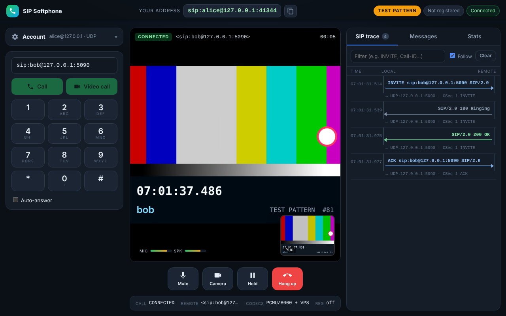

# SIP Softphone

A SIP softphone delivered as a **Java library** for automated call flows and SIP testing, built on
**Netty**, with two sample clients:

| Module | What it is |
|--------|------------|
| [`softphone-lib`](softphone-lib) | The jar. SIP (RFC 3261), SDP offer/answer (RFC 8866/3264), RTP/RTCP (RFC 3550), DTMF (RFC 4733), G.711, VP8/H.264 RTP payloads — every packet built and parsed with Netty. |
| [`clients/web-softphone`](clients/web-softphone) | Browser softphone with **audio and video** (WebCodecs + AudioWorklet), backed by a Netty gateway that runs one `Softphone` per tab. |
| [`clients/terminal-softphone`](clients/terminal-softphone) | Terminal softphone (audio only) with an interactive shell and a scriptable batch mode for tests. |



## Quick start

Requirements: JDK 21+. Everything else comes through the Gradle wrapper.

```bash
./gradlew build                                    # compile + ~190 tests + javadoc
```

**Library** — place an automated call:

```java
try (Softphone phone = Softphone.create(SoftphoneConfig.builder()
        .user("tester").domain("pbx.example.com").password("secret").sipPort(0).build()).start().join()) {

    Call call = phone.call("sip:ivr@pbx.example.com");
    RecordingSink heard = new RecordingSink();
    call.setAudioSink(heard);
    call.setAudioSource(new ToneSource(440, 0.3));
    call.connected().get(30, TimeUnit.SECONDS);

    call.sendDtmf("1234#").join();          // RFC 4733
    call.hold().join();                     // re-INVITE a=sendonly
    call.resume().join();
    call.hangup();                          // BYE
    System.out.println(call.ended().join());
}
```

**Web client** — `./gradlew :clients:web-softphone:run`, open two tabs:
`http://localhost:8080/?user=bob&sipPort=5090` and `http://localhost:8080/?user=alice`, then video-call
`sip:bob@127.0.0.1:5090` from alice.

**Terminal client**:

```bash
./gradlew :clients:terminal-softphone:installDist
T=clients/terminal-softphone/build/install/terminal-softphone/bin/terminal-softphone
$T --user bob --port 5070 --auto-answer --audio echo        # an echo endpoint
$T --user alice --port 0 --batch --exec "call sip:bob@127.0.0.1:5070; await connected 5; dtmf 123; wait 2; hangup"
```

## What is implemented

**SIP** — parser for the full RFC 3261 grammar (compact forms, folding, list headers), UDP / TCP / TLS transports
with `rport` (RFC 3581) and CRLF keep-alive (RFC 5626), RFC 3263 resolution (SRV + A), the four transaction state
machines with all timers and the RFC 6026 *Accepted* state, dialogs with route sets and strict/loose routing,
digest authentication (MD5, SHA-256, SHA-512/256, qop auth/auth-int), REGISTER with refresh and 423 handling,
INVITE with early dialogs, forking, 2xx retransmission, CANCEL, BYE, re-INVITE/hold with 491 glare handling,
INFO, MESSAGE, OPTIONS, and the UAS checks of §8.2 (405/420/481/501).

**SDP** — complete RFC 8866 model, lenient parser, writer, RFC 3264 negotiator (payload type mapping, direction
and hold, rtcp-mux, telephone-event, rejection with port 0, 488 when nothing matches).

**Media** — RTP/RTCP packets and sessions (SR/RR/SDES/BYE, PLI, FIR, NACK, statistics per RFC 3550 appendix A,
rtcp-mux, symmetric RTP), jitter buffer, G.711 μ/A-law, L16, RFC 4733 DTMF with in-band fallback, VP8 and
H.264 packetizers/depacketizers with loss detection and key frame requests.

**Automation hooks** — futures for every milestone, `awaitState`, message interceptors (trace / assert / drop /
rewrite), Netty pipeline customizers, tone/WAV sources, recording sinks with tone detection, shrinkable SIP
timers, ephemeral ports for parallel tests.

## Architecture

```
 Softphone / Call                      automation facade (call package)
 sip.session · sip.flow                INVITE session, REGISTER, generic requests with auth
 sip.core                              UA core: routing, request validation, dialog dispatch
 sip.dialog · sip.transaction          RFC 3261 §12 and §17
 sip.transport · sip.codec             Netty UDP/TCP/TLS, framing, resolver
 sip.message · sip.parser · sip.auth   message model and grammar, digest
 sdp                                   RFC 8866 / RFC 3264
 media · rtp                           RTP/RTCP, codecs, DTMF, video payloads
 Netty
```

SIP, SDP and media are independent of each other; only the `call` layer joins them. All SIP state runs on one
executor thread (no locks), network I/O on Netty event loops, and listener callbacks on a per-phone event thread.
Details: [docs/architecture/overview.md](docs/architecture/overview.md).

## Documentation

* [docs/README.md](docs/README.md) — index
* [Library usage](docs/guides/library-usage.md) and [extending the library](docs/guides/extending.md)
* Protocol notes: [SIP layers](docs/protocol/sip-layers.md), [transactions](docs/protocol/transactions.md),
  [call flows (ladders)](docs/protocol/call-flows.md), [SDP](docs/protocol/sdp-offer-answer.md),
  [RTP & media](docs/protocol/rtp-media.md)
* Clients: [web softphone](docs/clients/web-softphone.md), [terminal softphone](docs/clients/terminal-softphone.md)
* [Testing against real SIP services](docs/guides/testing-with-real-sip-services.md) and the [Asterisk interop harness](interop/asterisk/README.md)
* [Specification references](docs/references.md) — every RFC used and where it is implemented
* [Spec 019](docs/specs/019-library-first-netty-softphone/spec.md) — the decision record for this design

## Build reference

```bash
./gradlew :softphone-lib:test                     # library tests
./gradlew :softphone-lib:publishToMavenLocal      # use the jar from other local projects
./gradlew :clients:web-softphone:run --args="--http-port 8080"
./gradlew :clients:terminal-softphone:run --args="--user alice --port 5080"
```

Java 21 · Gradle 9 (wrapper) · Netty 4.2 · JUnit 6 · MIT License
