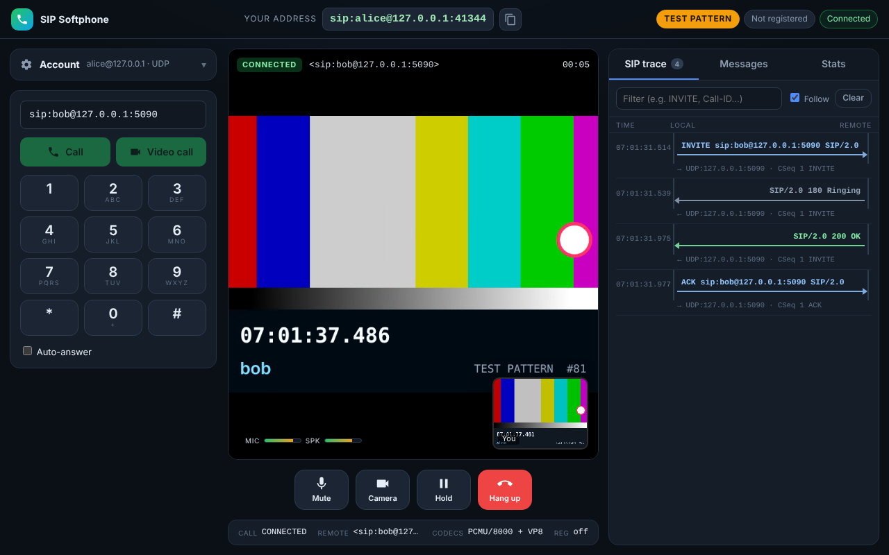

# Web softphone (audio + video)



The web softphone is a small Java server plus a browser UI. The **Java side is the SIP user agent**: each browser
tab gets its own `Softphone` from `softphone-lib` (SIP, SDP, RTP, DTMF, packetization). The **browser is the
head**: it captures and plays audio (AudioWorklet), encodes and decodes video (WebCodecs) and renders the UI.
They talk over one WebSocket ([protocol](web-softphone-protocol.md)).

```
 ┌──────── browser tab ────────┐   WebSocket /ws    ┌──────── web-softphone (JVM) ────────┐   SIP + RTP
 │ UI, SIP ladder, chat        │ ◄──── JSON ──────► │ BrowserSession ─► Softphone ─► Call  │ ◄──────────► any SIP
 │ mic/speaker  (AudioWorklet) │ ◄── PCM 8 kHz ───► │   AudioSource/Sink (G.711 encode)    │              device or
 │ camera/screen (WebCodecs)   │ ◄─ VP8/H.264 ────► │   VideoStream (RFC 7741 / 6184)      │              another tab
 └─────────────────────────────┘                    └──────────────────────────────────────┘
```

Why this design: browsers cannot speak plain SIP/RTP (only WebRTC with ICE + DTLS-SRTP). Keeping the protocol work
in the JVM means the browser client exercises exactly the same library code as any other consumer, and the
softphone can call ordinary SIP endpoints (desk phones, PBXs, other softphones) with plain RTP.

## Run

```bash
./gradlew :clients:web-softphone:run
# or: ./gradlew :clients:web-softphone:installDist && clients/web-softphone/build/install/web-softphone/bin/web-softphone
```

Open <http://localhost:8080/>. Browsers only allow camera/microphone on secure origins: `localhost` works over
plain HTTP; for other hosts start the server with `--tls-cert cert.pem --tls-key key.pem` (HTTPS).

Server options: `--http-port`, `--http-bind`, `--sip-bind`, `--sip-host` (address advertised in SIP/SDP, set it to
a LAN address to call other machines), `--rtp-ports MIN-MAX`, `--web-root DIR` (serve UI files from disk while
developing them).

## Calling between two tabs

1. Tab 1: open `http://localhost:8080/?user=bob&sipPort=5090` — the header shows `sip:bob@<host>:5090`.
2. Tab 2: open `http://localhost:8080/?user=alice`, enter `sip:bob@127.0.0.1:5090`, press **Video call**.
3. Answer in tab 1. Use the dialpad for DTMF, Hold, Mute, Camera, the **Messages** tab for SIP MESSAGE chat and
   the **SIP trace** tab to inspect every message on the wire.

## Features

* Account settings (user, domain, password, registrar, outbound proxy, UDP/TCP, port) stored in the browser;
  optional registration.
* Audio and video calls (VP8 preferred, H.264 constrained baseline), incoming call banner, auto-answer.
* DTMF (RFC 4733), hold/resume (re-INVITE), mute, camera toggle, call timer, level meters.
* Key frame recovery: decoder errors trigger a key frame request that becomes an RTCP PLI towards the remote
  party; PLI/FIR from the remote party force a key frame in the browser encoder.
* Synthetic media: when no camera/microphone is available (or with `?fake=1`) a moving test pattern and a tone are
  used, so the client works in headless CI.
* Live SIP ladder trace, chat, RTP statistics.

## URL parameters (automation)

`user, domain, displayName, password, authUser, registrar, outboundProxy, transport, sipPort, register` pre-fill
the account; `target`, `autocall=1`, `video=1`, `autoAnswer=1`, `fake=1`, `tone=<hz>` drive a call without any
clicks. `window.softphone` exposes live state and counters (`state`, `framesEncoded`, `framesDecoded`,
`audioChunksSent/Received`, `dtmfReceived`, `sipMessages`...) plus `call()`, `answer()`, `hangup()` and `send()`.

## End-to-end check

[`clients/web-softphone/e2e/two-tabs-video-call.js`](../../clients/web-softphone/e2e/two-tabs-video-call.js) starts
two headless Chromium tabs against a running server, places a video call between them, sends DTMF and hangs up,
and fails unless video frames were decoded and audio flowed in both directions:

```bash
./gradlew :clients:web-softphone:run --args="--http-port 8089 --http-bind 127.0.0.1 --sip-bind 127.0.0.1 --sip-host 127.0.0.1" &
node clients/web-softphone/e2e/two-tabs-video-call.js
```

Typical result: ~80 VP8 frames encoded/decoded each way in 5 s, 0 RTP packets lost, DTMF delivered.
