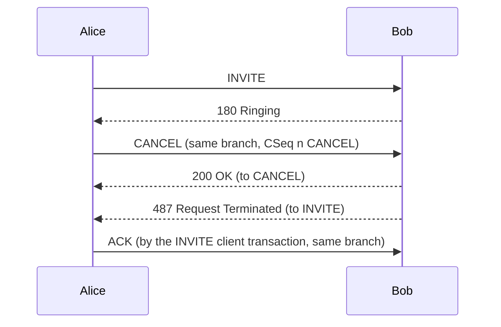
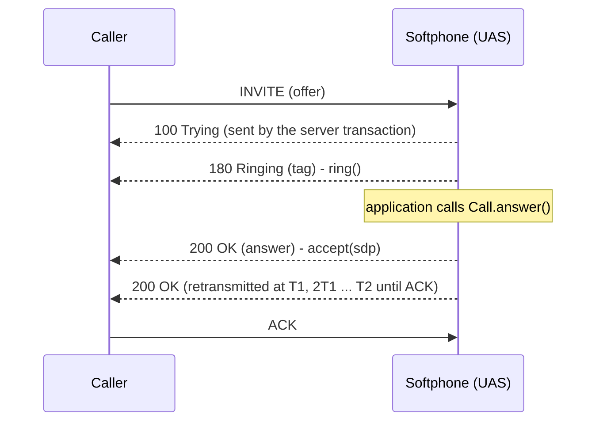
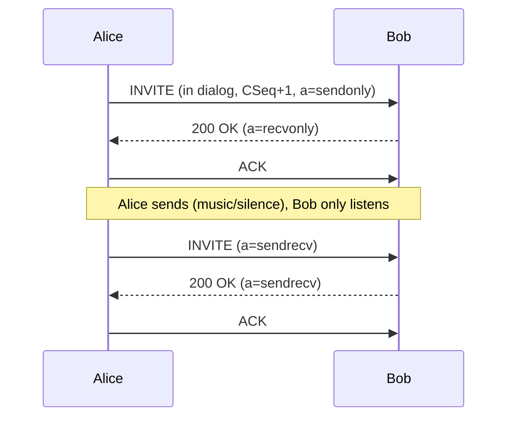

# Call flows

Each flow below is implemented by one class and exercised by an automated test. Diagrams use the message names
as they appear on the wire; the code references point to the method that produces each step.

## Registration with digest authentication — `sip.flow.Registration`

```mermaid
sequenceDiagram
    participant UA as Softphone
    participant R as Registrar
    UA->>R: REGISTER sip:example.com (CSeq 1, Contact;expires=3600)
    R-->>UA: 401 Unauthorized (WWW-Authenticate: Digest nonce=...)
    Note over UA: DigestAuthenticator.authorize (same Call-ID, CSeq+1)
    UA->>R: REGISTER (CSeq 2, Authorization: Digest ...)
    R-->>UA: 423 Interval Too Brief (Min-Expires: 7200)
    UA->>R: REGISTER (CSeq 3, expires=7200)
    R-->>UA: 200 OK (Contact;expires=7200)
    Note over UA: refresh scheduled at expires-30s
    UA->>R: REGISTER (expires=0) on unregister()
    R-->>UA: 200 OK
```

* RFC 3261 §10.2: To/From = AOR, constant Call-ID, increasing CSeq, Request-URI without user part.
* The granted lifetime is the `expires` parameter of *our* Contact in the 200, else the Expires header (§10.2.4).
* Test: `RegistrationTest`.

## Outgoing call — `InviteSession.outgoing(...).start()`

```mermaid
sequenceDiagram
    participant A as Alice (UAC)
    participant B as Bob (UAS)
    A->>B: INVITE (SDP offer, Contact, Allow)
    B-->>A: 100 Trying
    B-->>A: 180 Ringing (To;tag=b) - early dialog
    B-->>A: 183 Session Progress (SDP) - early media (optional)
    B-->>A: 200 OK (SDP answer, Contact)
    A->>B: ACK (new branch, CSeq n ACK, route set)
    Note over A,B: RTP / RTCP media
    A->>B: BYE
    B-->>A: 200 OK
```

* 401/407 on the INVITE: re-sent once with credentials, CSeq+1, same Call-ID/From tag.
* A 2xx with a *different* To tag after the dialog was confirmed (forking proxy) is ACKed and then released with
  BYE (§13.2.2.4).
* Tests: `InviteSessionTest.basicCallAndHangup` (UDP and TCP), `inviteIsAuthenticatedAfter407`.

## Cancelling — `InviteSession.cancel()`



* §9.1: CANCEL is only sent after a provisional response; if `cancel()` is called earlier it is deferred.
* If the 200 to the INVITE races the CANCEL, the call is released with BYE.
* Test: `InviteSessionTest.cancelWhileRinging`.

## Incoming call — `InviteSession.incoming(...)`



* No ACK within 64*T1: the callee sends BYE and reports `TIMEOUT` (§13.3.1.4) — test
  `missingAckTerminatesCallWithBye`.
* Lost ACK recovered by 2xx retransmission — test `lostAckIsRecoveredByRetransmitted2xx`.
* INVITE without SDP (delayed offer): our offer goes in the 200 and the answer is read from the ACK.

## Hold / resume (re-INVITE) — `Call.hold()`, `InviteSession.reinvite(...)`



* RFC 3264 §8.4 hold semantics; `c=0.0.0.0` (RFC 2543 style) from a peer is understood as hold too.
* Glare (§14.1): a re-INVITE received while ours is pending is answered 491; a 491 we receive is retried
  after a random 2.1-4 s.
* A re-INVITE requested while the previous INVITE still waits for its ACK is queued until the ACK arrives.
* Test: `InviteSessionTest.reinviteInBothDirections`, `SoftphoneCallTest.holdAndResume`.

## DTMF

* RFC 4733 telephone-event in the RTP stream (default, negotiated with `a=rtpmap:101 telephone-event/8000`).
* Received SIP INFO `application/dtmf-relay` (`Signal=5`) is reported through the same `onDtmf` callback.

## Messaging

* `Softphone.sendMessage(target, text)` sends an out-of-dialog MESSAGE (RFC 3428); `Call.sendMessage` sends one
  inside the call's dialog. Received messages are answered with 200 and reported to listeners.
