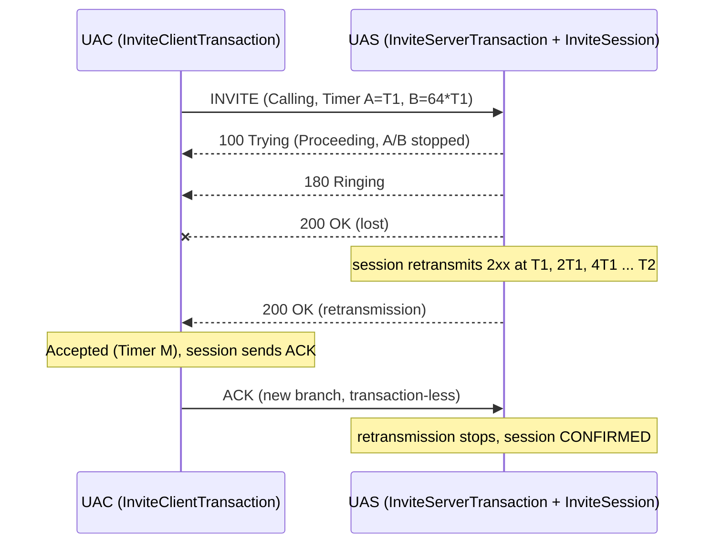

# Transactions (RFC 3261 §17, RFC 6026)

A transaction is a request plus all responses to it. The four state machines live in
`com.github.mikekwright.sip.softphone.sip.transaction`; each class carries the RFC figure in its Javadoc.

| Class | RFC | Initial state | Timers |
|-------|-----|---------------|--------|
| `InviteClientTransaction` | §17.1.1, RFC 6026 Fig. 3 | Calling | A (retransmit, UDP only), B (timeout), D (wait for retransmitted finals), M (Accepted) |
| `NonInviteClientTransaction` | §17.1.2 | Trying | E (retransmit, UDP only), F (timeout), K (Completed) |
| `InviteServerTransaction` | §17.2.1, RFC 6026 Fig. 5 | Proceeding | G (retransmit non-2xx final, UDP only), H (wait for ACK), I (Confirmed), L (Accepted) |
| `NonInviteServerTransaction` | §17.2.2 | Trying | J (Completed) |

## Timer values (Table 4)

`TimerSettings` holds T1 (500 ms), T2 (4 s) and T4 (5 s). Everything else derives from them:

| Timer | Value | Meaning |
|-------|-------|---------|
| A | T1, doubling | INVITE retransmit interval (unreliable transports) |
| B | 64*T1 | INVITE transaction timeout |
| D | 64*T1 UDP, 0 TCP | wait time for response retransmissions |
| E | T1 doubling up to T2 (T2 once Proceeding) | non-INVITE retransmit |
| F | 64*T1 | non-INVITE timeout |
| G | T1 doubling up to T2 | INVITE final response retransmit |
| H | 64*T1 | wait for ACK |
| I | T4 UDP, 0 TCP | wait for ACK retransmissions |
| J | 64*T1 UDP, 0 TCP | wait for non-INVITE request retransmissions |
| K | T4 UDP, 0 TCP | wait for response retransmissions |
| L | 64*T1 | (RFC 6026) wait for INVITE retransmissions after 2xx |
| M | 64*T1 | (RFC 6026) wait for 2xx retransmissions |

Tests construct stacks with `T1 = 10 ms` so that all timeout paths finish in well under a second.

## Matching

* **Client** (§17.1.3): top Via `branch` + CSeq method.
* **Server** (§17.2.3): top Via `branch` + `sent-by` + method, where an ACK matches the INVITE. Requests without
  the `z9hG4bK` magic cookie (RFC 2543 peers) fall back to Call-ID, From tag, CSeq and top Via.
* **CANCEL** creates its own server transaction; `TransactionLayer.findInviteFor(cancel)` locates the INVITE it
  targets (§9.2).

## What the transaction layer does *not* do

* ACK for a **2xx** is not part of the INVITE transaction: the UA core sends it with a new branch
  (`SipStack.sendAck`) and the UAS core retransmits the 2xx until the ACK arrives (§13.3.1.4). With RFC 6026 the
  client transaction stays in *Accepted* to hand 2xx retransmissions to the session, which re-sends the ACK.
* Authentication, redirection and dialog handling are TU (flow/session) responsibilities.

## Example: INVITE over UDP with a lost 200

